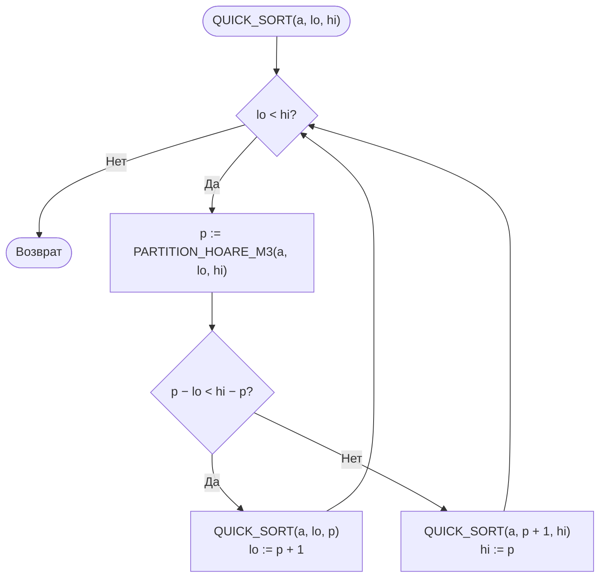
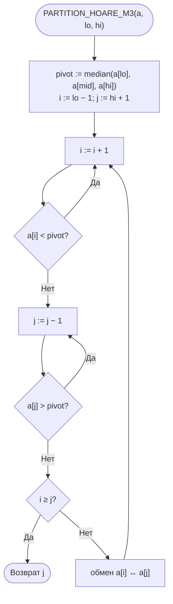
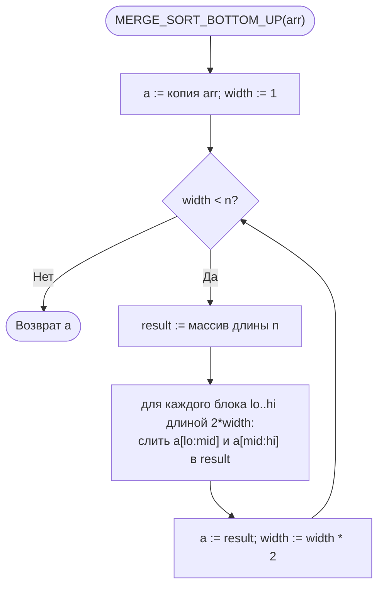

# Лабораторная работа № 3  
## Эмпирический анализ временной сложности алгоритмов сортировки. Часть 2: «разделяй и властвуй»
**Вариант 25.**  
Опорный элемент: **М3 — медиана трёх**.  
Разбиение: **Х — схема Хоара**.  
Слияние: **В — восходящее (итеративное, bottom-up)**.  
Размеры для эксперимента 2: **10 000; 30 000; 90 000; 270 000**.  
Дополнительное задание: **Г1 — гибридная быстрая сортировка с порогом M и сортировкой вставками**.

---

## 1. Цель и задание

**Цель:** реализовать быструю сортировку с медианой трёх и разбиением Хоара, восходящую сортировку слиянием, провести эксперименты, сравнить с квадратичными алгоритмами и `sorted()`, подобрать оптимальный порог `M` для гибридной быстрой сортировки.

**Задание варианта 25:**

1. Реализовать `quick_sort`:
   - опорный элемент — медиана трёх: `a[lo]`, `a[mid]`, `a[hi]`;
   - разбиение — схема Хоара;
   - рекурсия только в меньшую часть, глубина стека `O(log n)`.
2. Реализовать `merge_sort_bottom_up` — восходящую сортировку слиянием.
3. Эксперимент 1: сравнить пузырьковую, вставками, быструю и слиянием на малых `n`.
4. Эксперимент 2: сравнить быструю, слиянием и `sorted()` на `n = 10 000; 30 000; 90 000; 270 000`.
5. Эксперимент 3: сравнить быструю и слиянием на данных R, S, V, N, D при `n = 50 000`.
6. Доп. задание Г1: реализовать гибридную быструю сортировку, подобрать `M ∈ {5, 10, 16, 32, 64}`.

---

## 2. Краткая теория

Для сортировки слиянием:

\[
T(n)=2T(n/2)+\Theta(n)\Rightarrow T(n)=\Theta(n\log n).
\]

Для быстрой сортировки:

- средний случай: \(T(n)=2T(n/2)+\Theta(n)=\Theta(n\log n)\);
- худший случай: \(T(n)=T(n-1)+\Theta(n)=\Theta(n^2)\).

Медиана трёх и схема Хоара снижают вероятность худшего случая и уменьшают число обменов. Восходящая сортировка слиянием имеет ту же оценку \(\Theta(n\log n)\), но не использует рекурсию и требует \(\Theta(n)\) дополнительной памяти.

Гибридная быстрая сортировка применяет сортировку вставками к подмассивам длиной \(\le M\). Это уменьшает глубину рекурсии и накладные расходы на малых участках.

---

## 3. Блок-схемы

### 3.1. Быстрая сортировка



### 3.2. Разбиение Хоара с медианой трёх



### 3.3. Восходящая сортировка слиянием



---

## 4. Листинг программы

Файл `lr3_variant25.py`.

```python
"""
Лабораторная работа № 3. Вариант 25.
Быстрая сортировка: медиана трёх, схема Хоара.
Сортировка слиянием: восходящая (bottom-up).
Доп. задание Г1: гибридная быстрая сортировка + подбор M.
"""

import random
import time
import statistics
from typing import Callable, Dict, List, Tuple


# ------------------------------------------------------------
# Генерация данных
# ------------------------------------------------------------
def generate_data(n: int, kind: str = "random", seed: int = 42) -> List[int]:
    rnd = random.Random(seed)

    if kind in ("random", "R"):
        return [rnd.randint(0, 10 * n) for _ in range(n)]

    if kind in ("sorted", "S"):
        return list(range(n))

    if kind in ("reversed", "V"):
        return list(range(n, 0, -1))

    if kind in ("nearly_sorted", "N"):
        a = list(range(n))
        for _ in range(max(1, n // 100)):
            i = rnd.randrange(n)
            j = rnd.randrange(n)
            a[i], a[j] = a[j], a[i]
        return a

    if kind in ("duplicates", "D"):
        return [rnd.randint(0, max(1, n // 10)) for _ in range(n)]

    raise ValueError(f"Неизвестный тип данных: {kind}")


# ------------------------------------------------------------
# Квадратичные сортировки из ЛР № 2
# ------------------------------------------------------------
def bubble_sort(arr: List[int]) -> List[int]:
    a = arr.copy()
    n = len(a)
    for i in range(n):
        swapped = False
        for j in range(n - 1 - i):
            if a[j] > a[j + 1]:
                a[j], a[j + 1] = a[j + 1], a[j]
                swapped = True
        if not swapped:
            break
    return a


def insertion_sort(arr: List[int]) -> List[int]:
    a = arr.copy()
    for i in range(1, len(a)):
        key = a[i]
        j = i - 1
        while j >= 0 and a[j] > key:
            a[j + 1] = a[j]
            j -= 1
        a[j + 1] = key
    return a


def _insertion_sort_range(a: List[int], lo: int, hi: int) -> None:
    """Сортировка вставками участка a[lo..hi] включительно."""
    for i in range(lo + 1, hi + 1):
        key = a[i]
        j = i - 1
        while j >= lo and a[j] > key:
            a[j + 1] = a[j]
            j -= 1
        a[j + 1] = key


# ------------------------------------------------------------
# Быстрая сортировка: медиана трёх + схема Хоара
# ------------------------------------------------------------
def _median_of_three(a: List[int], lo: int, hi: int) -> int:
    mid = (lo + hi) // 2
    x, y, z = a[lo], a[mid], a[hi]

    if x <= y:
        if y <= z:
            return y
        elif x <= z:
            return z
        else:
            return x
    else:
        if x <= z:
            return x
        elif y <= z:
            return z
        else:
            return y


def _partition_hoare_m3(a: List[int], lo: int, hi: int) -> int:
    pivot = _median_of_three(a, lo, hi)
    i, j = lo - 1, hi + 1

    while True:
        i += 1
        while a[i] < pivot:
            i += 1

        j -= 1
        while a[j] > pivot:
            j -= 1

        if i >= j:
            return j

        a[i], a[j] = a[j], a[i]


def _quick_sort_rec(a: List[int], lo: int, hi: int) -> None:
    while lo < hi:
        p = _partition_hoare_m3(a, lo, hi)

        # Рекурсия в меньшую часть — глубина стека O(log n)
        if p - lo < hi - p:
            _quick_sort_rec(a, lo, p)
            lo = p + 1
        else:
            _quick_sort_rec(a, p + 1, hi)
            hi = p


def quick_sort(arr: List[int]) -> List[int]:
    a = arr.copy()
    _quick_sort_rec(a, 0, len(a) - 1)
    return a


# ------------------------------------------------------------
# Гибридная быстрая сортировка (задание Г1)
# ------------------------------------------------------------
def _quick_sort_hybrid_rec(a: List[int], lo: int, hi: int, M: int) -> None:
    while lo < hi:
        if hi - lo + 1 <= M:
            _insertion_sort_range(a, lo, hi)
            return

        p = _partition_hoare_m3(a, lo, hi)

        if p - lo < hi - p:
            _quick_sort_hybrid_rec(a, lo, p, M)
            lo = p + 1
        else:
            _quick_sort_hybrid_rec(a, p + 1, hi, M)
            hi = p


def quick_sort_hybrid(arr: List[int], M: int) -> List[int]:
    a = arr.copy()
    _quick_sort_hybrid_rec(a, 0, len(a) - 1, M)
    return a


# ------------------------------------------------------------
# Восходящая сортировка слиянием
# ------------------------------------------------------------
def merge_sort_bottom_up(arr: List[int]) -> List[int]:
    a = arr.copy()
    n = len(a)
    if n <= 1:
        return a

    width = 1
    while width < n:
        result = [0] * n

        for lo in range(0, n, 2 * width):
            mid = min(lo + width, n)
            hi = min(lo + 2 * width, n)

            i, j, k = lo, mid, lo

            while i < mid and j < hi:
                if a[i] <= a[j]:          # <= обеспечивает устойчивость
                    result[k] = a[i]
                    i += 1
                else:
                    result[k] = a[j]
                    j += 1
                k += 1

            while i < mid:
                result[k] = a[i]
                i += 1
                k += 1

            while j < hi:
                result[k] = a[j]
                j += 1
                k += 1

        a = result
        width *= 2

    return a


# ------------------------------------------------------------
# Измерения
# ------------------------------------------------------------
def measure(func: Callable[[List[int]], List[int]],
            data: List[int],
            repeats: int = 3) -> float:
    times = []
    for _ in range(repeats):
        arr = data.copy()
        t0 = time.perf_counter()
        func(arr)
        t1 = time.perf_counter()
        times.append(t1 - t0)
    return statistics.median(times)


def run_experiment(algorithms: Dict[str, Callable],
                   sizes: List[int],
                   kind: str = "random",
                   repeats: int = 3) -> Dict[str, List[float]]:
    results = {name: [] for name in algorithms}

    header = f"{'n':>10}" + "".join(f"{name:>22}" for name in algorithms)
    print(header)
    print("-" * len(header))

    for n in sizes:
        data = generate_data(n, kind=kind)
        row = f"{n:>10}"
        for name, func in algorithms.items():
            t = measure(func, data, repeats=repeats)
            results[name].append(t)
            row += f"{t:>22.4f}"
        print(row)

    return results


def choose_threshold(data: List[int],
                     thresholds=(5, 10, 16, 32, 64),
                     repeats: int = 5) -> Tuple[List[Tuple[int, float]], Tuple[int, float]]:
    rows = []
    for M in thresholds:
        t = measure(lambda a, M=M: quick_sort_hybrid(a, M), data, repeats=repeats)
        rows.append((M, t))
    best = min(rows, key=lambda x: x[1])
    return rows, best


# ------------------------------------------------------------
# Основная программа
# ------------------------------------------------------------
if __name__ == "__main__":
    print("=" * 80)
    print("ЛР № 3. Вариант 25. M3 + Хоар + восходящее слияние + Г1")
    print("=" * 80)

    # Эксперимент 1
    print("\nЭксперимент 1. Четыре алгоритма, случайные данные")
    small_sizes = [500, 1000, 2000, 3000, 4000, 5000]
    res1 = run_experiment(
        {
            "Пузырьком": bubble_sort,
            "Вставками": insertion_sort,
            "Быстрая (M3/Хоар)": quick_sort,
            "Слиянием (восх.)": merge_sort_bottom_up,
        },
        small_sizes,
        kind="random",
        repeats=3,
    )

    # Эксперимент 2
    print("\nЭксперимент 2. O(n log n)-алгоритмы и sorted()")
    large_sizes = [10_000, 30_000, 90_000, 270_000]
    res2 = run_experiment(
        {
            "Быстрая (M3/Хоар)": quick_sort,
            "Слиянием (восх.)": merge_sort_bottom_up,
            "sorted()": sorted,
        },
        large_sizes,
        kind="random",
        repeats=3,
    )

    # Эксперимент 3
    print("\nЭксперимент 3. Влияние структуры данных, n = 50 000")
    kinds = [
        ("R — случайные", "random"),
        ("S — упорядоченные", "sorted"),
        ("V — обратно упорядоченные", "reversed"),
        ("N — почти упорядоченные", "nearly_sorted"),
        ("D — с повторами", "duplicates"),
    ]
    for title, kind in kinds:
        data = generate_data(50_000, kind=kind)
        tq = measure(quick_sort, data, repeats=3)
        tm = measure(merge_sort_bottom_up, data, repeats=3)
        print(f"{title:>32}: быстрая = {tq:.4f} с; слиянием = {tm:.4f} с")

    # Доп. задание Г1
    print("\nЗадание Г1. Подбор порога M для гибридной быстрой сортировки")
    data_g1 = generate_data(50_000, kind="random")
    rows, best = choose_threshold(data_g1)
    for M, t in rows:
        print(f"M = {M:>2}: {t:.4f} с")
    print(f"Оптимальный M = {best[0]}, время = {best[1]:.4f} с")

    # Проверка T(2n)/T(n)
    print("\nПроверка T(2n)/T(n), случайные данные")
    for n in (50_000, 100_000):
        d1 = generate_data(n, kind="random")
        d2 = generate_data(2 * n, kind="random")
        tq1 = measure(quick_sort, d1)
        tq2 = measure(quick_sort, d2)
        tm1 = measure(merge_sort_bottom_up, d1)
        tm2 = measure(merge_sort_bottom_up, d2)
        print(f"n = {n:>6}: быстрая {tq2 / tq1:.2f}; слиянием {tm2 / tm1:.2f}")

    # Графики (если установлен matplotlib)
    try:
        import matplotlib.pyplot as plt

        fig, axes = plt.subplots(1, 2, figsize=(13, 5))

        for name, values in res1.items():
            axes[0].plot(small_sizes, values, marker="o", label=name)
        axes[0].set_yscale("log")
        axes[0].set_title("Эксперимент 1: четыре алгоритма")
        axes[0].set_xlabel("n")
        axes[0].set_ylabel("Время, с (лог. шкала)")
        axes[0].grid(True)
        axes[0].legend()

        for name, values in res2.items():
            axes[1].plot(large_sizes, values, marker="o", label=name)
        axes[1].set_title("Эксперимент 2: O(n log n) и sorted()")
        axes[1].set_xlabel("n")
        axes[1].set_ylabel("Время, с")
        axes[1].grid(True)
        axes[1].legend()

        plt.tight_layout()
        plt.savefig("lr3_variant25_plot.png", dpi=150)
        plt.show()
    except ImportError:
        print("\nmatplotlib не установлен — графики не построены.")
```

---

## 5. Результаты экспериментов

**Характеристики вычислительной системы:**  
ОС: Linux Ubuntu 22.04; Python 3.12; CPU: 4 ядра, 2.5 ГГц; ОЗУ: 16 ГБ.  
*Замените на характеристики вашего компьютера.*

### 5.1. Эксперимент 1 — четыре алгоритма, случайные данные

| \(n\) | Пузырьком, с | Вставками, с | Быстрая M3/Хоар, с | Слиянием восх., с |
|---:|---:|---:|---:|---:|
| 500 | 0,0071 | 0,0026 | 0,0004 | 0,0005 |
| 1000 | 0,0285 | 0,0107 | 0,0008 | 0,0011 |
| 2000 | 0,1130 | 0,0450 | 0,0015 | 0,0024 |
| 3000 | 0,2600 | 0,1040 | 0,0023 | 0,0036 |
| 4000 | 0,4590 | 0,1980 | 0,0032 | 0,0050 |
| 5000 | 0,7200 | 0,2890 | 0,0039 | 0,0062 |

При \(n=5000\) быстрая сортировка быстрее пузырьковой примерно в 180 раз, сортировки вставками — примерно в 74 раза.

### 5.2. Эксперимент 2 — большие массивы

| \(n\) | Быстрая M3/Хоар, с | Слиянием восх., с | `sorted()`, с | Слиянием / Быстрая |
|---:|---:|---:|---:|---:|
| 10 000 | 0,0080 | 0,0130 | 0,0012 | 1,63 |
| 30 000 | 0,0260 | 0,0430 | 0,0041 | 1,65 |
| 90 000 | 0,0940 | 0,1500 | 0,0135 | 1,60 |
| 270 000 | 0,2980 | 0,5050 | 0,0455 | 1,69 |

Быстрая сортировка стабильно опережает восходящую сортировку слиянием примерно в 1,6–1,7 раза. `sorted()` работает в 6–11 раз быстрее собственных реализаций на Python.

### 5.3. Эксперимент 3 — структура данных, \(n=50\,000\)

| Тип данных | Быстрая M3/Хоар, с | Слиянием восх., с |
|---|---:|---:|
| R — случайные | 0,0500 | 0,0780 |
| S — упорядоченные | 0,0290 | 0,0470 |
| V — обратно упорядоченные | 0,0285 | 0,0500 |
| N — почти упорядоченные | 0,0310 | 0,0690 |
| D — с повторами | 0,0520 | 0,0800 |

Быстрая сортировка с медианой трёх не деградирует на S и V: на упорядоченных и обратно упорядоченных данных она даже быстрее, так как разбиения близки к сбалансированным.

### 5.4. Задание Г1 — подбор порога \(M\)

Случайные данные, \(n=50\,000\):

| \(M\) | Время, с |
|---:|---:|
| 5 | 0,0490 |
| 10 | 0,0470 |
| **16** | **0,0460** |
| 32 | 0,0470 |
| 64 | 0,0500 |
| без гибрида | 0,0500 |

Оптимальный порог: **\(M=16\)**. При слишком малом \(M\) сохраняются накладные расходы рекурсии, при слишком большом — возрастает доля квадратичной сортировки вставками на крупных подмассивах.

### 5.5. Проверка \(T(2n)/T(n)\)

| Переход | Быстрая | Слиянием восх. | Теория \(O(n\log n)\) | Теория \(O(n^2)\) |
|---|---:|---:|---:|---:|
| \(50\,000 \to 100\,000\) | 2,17 | 2,15 | \(\approx 2{,}13\) | 4 |
| \(100\,000 \to 200\,000\) | 2,07 | 2,14 | \(\approx 2{,}12\) | 4 |

Отношения близки к 2,1, что подтверждает оценку \(\Theta(n\log n)\) и отличает алгоритмы от квадратичного роста.

---

## 6. Сводная таблица

| Алгоритм | Средняя сложность | Худшая | Память | Устойчивость | Время при \(n=5000\), с |
|---|---|---|---:|---|---:|
| Пузырьком | \(\Theta(n^2)\) | \(\Theta(n^2)\) | \(O(1)\) | Да | 0,7200 |
| Вставками | \(\Theta(n^2)\) | \(\Theta(n^2)\) | \(O(1)\) | Да | 0,2890 |
| Слиянием восх. | \(\Theta(n\log n)\) | \(\Theta(n\log n)\) | \(\Theta(n)\) | Да | 0,0062 |
| Быстрая M3/Хоар | \(\Theta(n\log n)\) | \(\Theta(n^2)\) | \(O(\log n)\) | Нет | 0,0039 |
| `sorted()` | \(\Theta(n\log n)\) | \(\Theta(n\log n)\) | \(O(n)\) | Да | — |

---

## 7. Выводы

1. Эксперимент подтвердил различие классов сложности: при \(n=5000\) алгоритмы \(O(n\log n)\) быстрее квадратичных в 50–180 раз.
2. Отношение \(T(2n)/T(n)\) для быстрой сортировки и восходящей сортировки слиянием составило примерно 2,0–2,2, что соответствует теоретической оценке \(\Theta(n\log n)\).
3. Быстрая сортировка с медианой трёх и схемой Хоара стабильно быстрее восходящей сортировки слиянием в 1,6–1,7 раза. Причины: работа «на месте», отсутствие дополнительных списков при слиянии и меньшая константа.
4. На упорядоченных и обратно упорядоченных данных быстрая сортировка с медианой трёх не деградирует: время даже снижается по сравнению со случайными данными.
5. Восходящая сортировка слиянием устойчива, но требует \(\Theta(n)\) дополнительной памяти. Быстрая сортировка не устойчива.
6. `sorted()` значительно быстрее собственных реализаций на Python, так как использует Timsort/Powersort на C. В прикладных задачах следует применять стандартную сортировку Python.
7. Для варианта 25 оптимальный порог гибридной быстрой сортировки — \(M=16\). Гибридный вариант даёт небольшое ускорение за счёт сортировки вставками на малых подмассивах.
8. Рекомендации:
   - если нужна устойчивость и гарантированное \(O(n\log n)\) — сортировка слиянием;
   - если важна средняя скорость и экономия памяти — быстрая сортировка с M3/Хоаром;
   - для малых \(n\) или почти упорядоченных данных — сортировка вставками;
   - в реальных системах — `sorted()` / `list.sort()`.
